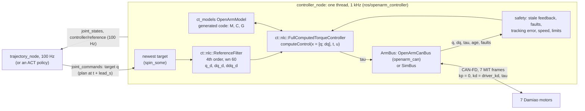

# control-toolbox + OpenArm (branch `openarm-ctc`)

This branch starts from the original [ETH ADRL control-toolbox](https://github.com/ethz-adrl/control-toolbox)
release `v3.0.2` (commit `7d36e42`, full upstream history kept) and adds the OpenArm v1 robot and model-based
controllers in the toolbox's own structure, so they sit next to its optimal-control solvers (`ct_optcon`: LQR,
iLQR/GNMS NLOC, MPC, DMS) and can use them directly. The upstream `README.md` is unchanged; this file describes the
additions.

## Layout

| Path | Content |
| --- | --- |
| `ct_core`, `ct_optcon`, `ct_rbd` | upstream toolbox (systems, integrators, `ct::core::Controller`; optimal control; rigid-body tools) |
| `ct_models/include/ct/models/OpenArm` | **OpenArm model**, namespace `ct::models::OpenArm`: `OpenArmModel<NJ>` (M, C, G from generated code, 7 or 14 joints in any order) and `OpenArmSystem<NJ>` (`ct::core::ControlledSystem`) |
| `ct_models/include/ct/models/OpenArm/codegen` | the generated code: `OpenArmLeftModel`, `OpenArmRightModel` (plain C++, input `[q; dq]`, output M, C, G) and the joint limits |
| `ct_models/src/OpenArm/codegen` | **code generator module** `OpenArmModelCodegen` (Pinocchio + `ct::core::DerivativesCppadCG`); run only when the URDF changes |
| `ct_models/urdf/OpenArm` | official OpenArm v1 bimanual URDF |
| `ct_nlc` | **new package, nonlinear controllers**, namespace `ct::nlc`, at the level of `ct_optcon`: `ModelBasedJointController`, `ComputedTorqueController`, `FullComputedTorqueController`, `GravityCompensationController`, `ReferenceFilter`, `ReferenceAccelerationEstimator` |
| `ros/openarm_trajectory` | ROS 2 node `trajectory_node`: plays a trajectory file, publishes only the target positions `joint_commands` (no velocity) at 100 Hz (plan at t + `lead_s`) |
| `ros/openarm_controller` | ROS 2 node `controller_node`: **the 1 kHz control loop of one arm in one thread with the motor bus inside** (openarm_can on the robot, or a simulated arm): reference filter + full computed-torque control from `ct_nlc`; launch file |
| `ct/install_deps_ubuntu22.sh` | installs ROS 2 Humble and all dependencies on Ubuntu 22.04 (versions pinned as in `ct/install_cppadcg.sh`, `ct/install_hpipm.sh`) |
| `colcon.meta` | toolbox build options (tests and examples on; Python plotting of `ct_core` off) |

Changes to upstream files: `ct_core/CMakeLists.txt` (configures with Python disabled), `ct_optcon/examples`
(examples re-enabled), `ct_optcon/cmake/ct_optconConfig.cmake` (finds BLASFEO/HPIPM in `/opt`),
`ct_models` (OpenArm added to `CMakeLists.txt`, `CodegenOutputDirs.h.in` and `test/`).

## Model: Pinocchio code generation

```
urdf/OpenArm ──Pinocchio, CppADCodeGen scalar──▶ ct::core::DerivativesCppadCG ──▶ codegen/OpenArm{Left,Right}Model.{h,cpp}
             (OpenArmModelCodegen, offline, ~30 ms)                                 input [q; dq] (7+7), output M, C, G
```

The generated files are straight-line C++ that depend only on Eigen and `ct_core`; Pinocchio is not needed to
build or run the model. They match Pinocchio (double precision) to 1e-9 for M, C, G and inverse dynamics on 40
random states (`ct_models/test/OpenArm/OpenArmModelTest.cpp`); M, C, G of both arms take about 3 µs.

Regenerate after a URDF change (the generator is built when Pinocchio is installed):

```bash
./build/ct_models/OpenArmModelCodegen     # rewrites ct_models/include/ct/models/OpenArm/codegen
cd ct_models/test/OpenArm && python3 generate_reference_values.py ../../urdf/OpenArm/openarm_v1_bimanual.urdf \
    data/openarm_reference_values.csv     # reference values for the test
```

## Controllers (`ct_nlc`)

All controllers are `ct::core::Controller<2*NJ, NJ>` in the toolbox's form: copy constructor, virtual destructor,
`clone()` override and `computeControl(x, t, u)` override, so they run in `ct::core` integrators and simulators
like any toolbox controller.

- `ModelBasedJointController<NJ, MODEL>`: base class. The controller holds its own model (cloned with it), takes the
  reference with `setReference(q_d, dq_d, ddq_d)`, the state `x = [q; dq]` and time in `computeControl`, evaluates
  M, C, G with the model and limits the torque (`setTorqueLimit`).
- `ComputedTorqueController`: `u = M (ddq_d + Kp (q_d - q) + Kd (dq_d - dq)) + C dq* + G`, with the model at the
  reference or at the measured state. With `Kp = Kd = 0` at the reference it is the feedforward
  `tau_ff = M(q_d) ddq_d + C(q_d, dq_d) dq_d + G(q_d)` for a motor driver that closes the PD loop itself.
- `FullComputedTorqueController`: the controller tuned on the robot, for motor drivers with kp = kd = 0 (the PC
  sends the whole torque), gains in torque units per joint:
  `u = M(q) ddq_d + C(q, dq) dq + G(q) + b + fc tanh(dq_d / v) + fv dq_d + Kp (q_d - q) + Kd (dq_d - dq) + Ki ∫(q_d - q)`
  (model correction `b`, friction feedforward, clamped integral that runs only while active).
- `GravityCompensationController`: `u = G(q_d)` or `G(q)`.
- `ReferenceFilter`: smooth `q_d, dq_d, ddq_d` at the control rate from a slower stream of target positions
  (critically damped 4th order, `q_d / u = wn^4 / (s + wn)^4`, lag ~4 / wn).
- `ReferenceAccelerationEstimator`: `ddq_d` from a stream of `dq_d` (difference, low-pass, clamp).

Example (`ct_nlc/examples/OpenArmComputedTorque.cpp`): the right arm in simulation follows a 0.5 Hz sine on all
joints, starting 0.05 rad off; largest `|q_d - q|` after 1 s: 2.5e-5 rad with computed-torque control (Kp 100,
Kd 20), 0.015 rad with the feedforward plus the driver PD (kp 35, kd 1.2) (exact model, no friction).

```bash
./build/ct_nlc/examples/ex_OpenArmComputedTorque
```

### Adding a controller (e.g. MPC)

1. Derive from `ct::nlc::ModelBasedJointController<NJ, MODEL>` (or directly from `ct::core::Controller`),
   override `computeControl()` and `clone()`, and give it a copy constructor and a virtual destructor
   (see `PDGravityController` in `ct_nlc/test/ComputedTorqueControllerTest.cpp`).
2. For the robot: the 1 kHz loop calls the controller in `ControlLoop::step()`
   (`ros/openarm_controller/src/control_loop.cpp`, member `full_ctc_`); give the new controller the same reference
   and state there. The bus, the safety checks, the reference filter, the topics and the trajectory node stay the
   same, and `test_control_loop` runs it on the simulated arm.

For optimal control, `ct::models::OpenArm::OpenArmSystem<NJ>` is the model as a `ct::core::ControlledSystem`
(`dx = [dq; M^-1 (u - C dq - G)]`), which `ct_optcon` solvers accept.

## Control architecture



The trajectory source only gives positions at 100 Hz (`joint_commands` has no velocity; a file may have only the
columns t, q1..q7): `dq_d` and `ddq_d` come from the reference filter. Each 1 ms cycle the controller node takes the newest target,
lets the reference filter produce a smooth `q_d, dq_d, ddq_d`, computes the full computed-torque control with the
generated model and sends one MIT frame per motor with the driver's position gain at 0, then reads the replies.
Everything runs in one thread (`spin_some` in the loop, SCHED_FIFO when allowed), so there is no queue or lock
between the reference, the controller and the CAN bus. The trajectory node sends the plan `lead_s` = 4 / wn + 5 ms
ahead (as an action chunk gives future targets), which cancels the filter lag.

Safety in the loop: at start every motor must reply, be fault-free, disabled and inside the URDF limits; then the
motors are enabled with the driver PD (`hold_kp`, `hold_kd`) and the model feedforward, gains ramped in; full CTC is
blended in over `blend_s` when the first target arrives. Stale feedback (`max_age`) or a motor fault disables at
once. A tracking error, speed or position-limit violation brings the reference to rest through the filter and
blends back to the driver PD. Ctrl+C returns the arm to its start pose, ramps down and disables; a second Ctrl+C
disables at once.

All node parameters are read once at start from `ros/openarm_trajectory/config/trajectory.yaml` and
`ros/openarm_controller/config/controller.yaml` (no defaults in the code; a missing parameter stops the node with
its name), so changing a value needs a restart, not a rebuild.

### Result on the robot (right arm, figure eight with 3 s holds)

| | joint RMSE J1..J7 [mrad] | mean |
| --- | --- | --- |
| 500 Hz, 500 Hz file (positions, velocities, accelerations) | 3.6 / 3.8 / 2.4 / 5.0 / 4.7 / 2.3 / 2.5 | 3.5 |
| 100 Hz positions → ReferenceFilter (wn 60) → 1 kHz | 3.6 / 3.7 / 3.3 / 5.0 / 4.4 / 2.6 / 2.5 | 3.6 |

Both with the parameters of `controller.yaml`, 0 overruns, no torque clamping; at 1 kHz the feedback is 1 ms old
(2 ms at 500 Hz) and the CAN bus is ~70 % loaded (14 frames of ~50 µs per cycle). The largest errors are in the
holds (static friction), not in the motion. Steps of the tuning, from 8.6 mrad (pure full CTC) to 3.5 mrad: friction
feedforward, model correction from a static gravity check, integral.

## Build and test

Ubuntu 22.04:

```bash
./ct/install_deps_ubuntu22.sh        # ROS 2 Humble + all toolbox/OpenArm dependencies (pinned versions)
source /opt/ros/humble/setup.bash
colcon build                         # from the repository root; colcon.meta sets the toolbox options
colcon test && colcon test-result --verbose
```

Checked on a fresh clone of this branch in Ubuntu 22.04 (system set up by the script): 7 packages build, all
tests pass (ct_models incl. upstream HyA/IKFast/Quadrotor tests, ct_nlc, launch test of both nodes), the 11
`ct_optcon` examples and `ex_OpenArmComputedTorque` run to the end. Without openarm_can, `controller_node` is built
with the simulated arm only.

Tests of the 1 kHz pipeline: `ct_nlc/test/FullComputedTorqueControllerTest` (control law, integral, clone, filter
step and ramp response, full CTC on a 100 Hz stream in a `ct::core` simulation), `ros/openarm_controller/test`
(`test_control_loop`: tracking, user stop, soft and hard stops on the simulated arm; launch test of both nodes
with the simulated arm, ending with Ctrl+C: return, ramp down, disable, log written).

## Run

```bash
source install/setup.bash
ros2 launch openarm_controller trajectory_controller.launch.py                     # simulated arm (bus: sim)
ros2 launch openarm_controller trajectory_controller.launch.py bus:=can log_dir:=$HOME/openarm_logs   # the robot
./build/ct_nlc/examples/ex_OpenArmComputedTorque                   # OpenArm with computed-torque control (simulation)
./build/ct_optcon/examples/ex_NLOC                                 # toolbox example: iLQR on an oscillator
```

On the robot (CAN-FD up on `can0`, E-stop in reach): the arm ramps in at its current pose, moves to the start of
the trajectory, follows it, returns and holds. Ctrl+C ends the run (return to the start pose, ramp down, disable).
Other trajectories: `trajectory_file:=` (e.g. `share/openarm_trajectory/trajectories/hold_cart_posture_100hz.csv`
to stand still, `cart_figure8_fast_100hz.csv` for the figure eight in 17 s). With `log_dir`, every cycle is written
to `log_dir/<label>/log.csv` (+ `meta.json`).
