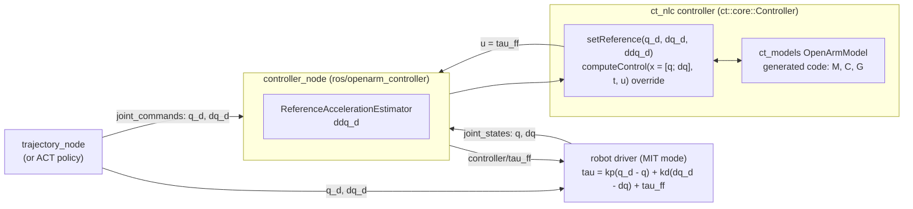

# control-toolbox + OpenArm (branch `openarm-ctc`)

This branch starts from the original [ETH ADRL control-toolbox](https://github.com/ethz-adrl/control-toolbox)
release `v3.0.2` (commit `7d36e42`, full upstream history kept) and adds the OpenArm v1 robot and model-based
controllers in the toolbox's own structure, so they sit next to its optimal-control solvers (`ct_optcon`: LQR,
iLQR/GNMS NLOC, MPC, DMS) and can use them directly. The upstream `README.md` is unchanged; this file describes the
additions.

## Layout

| Path | Content |
| --- | --- |
| `ct_core`, `ct_optcon`, `ct_rbd` | upstream toolbox (systems, integrators, `ct::core::Controller`; optimal control; rigid-body tools) |
| `ct_models/include/ct/models/OpenArm` | **OpenArm model**, namespace `ct::models::OpenArm`: `OpenArmModel<NJ>` (M, C, G from generated code, 7 or 14 joints in any order) and `OpenArmSystem<NJ>` (`ct::core::ControlledSystem`) |
| `ct_models/include/ct/models/OpenArm/codegen` | the generated code: `OpenArmLeftModel`, `OpenArmRightModel` (plain C++, input `[q; dq]`, output M, C, G) and the joint limits |
| `ct_models/src/OpenArm/codegen` | **code generator module** `OpenArmModelCodegen` (Pinocchio + `ct::core::DerivativesCppadCG`); run only when the URDF changes |
| `ct_models/urdf/OpenArm` | official OpenArm v1 bimanual URDF |
| `ct_nlc` | **new package, nonlinear controllers**, namespace `ct::nlc`, at the level of `ct_optcon`: `ModelBasedJointController`, `ComputedTorqueController`, `GravityCompensationController`, `ReferenceAccelerationEstimator` |
| `ros/openarm_trajectory` | ROS 2 node `trajectory_node`: plays a trajectory file, publishes `joint_commands` (q, dq) at 400 Hz |
| `ros/openarm_controller` | ROS 2 node `controller_node`: calls a `ct_nlc` controller, publishes `controller/tau_ff`; launch file |
| `ct/install_deps_ubuntu22.sh` | installs ROS 2 Humble and all dependencies on Ubuntu 22.04 (versions pinned as in `ct/install_cppadcg.sh`, `ct/install_hpipm.sh`) |
| `colcon.meta` | toolbox build options (tests and examples on; Python plotting of `ct_core` off) |

Changes to upstream files: `ct_core/CMakeLists.txt` (configures with Python disabled), `ct_optcon/examples`
(examples re-enabled), `ct_optcon/cmake/ct_optconConfig.cmake` (finds BLASFEO/HPIPM in `/opt`),
`ct_models` (OpenArm added to `CMakeLists.txt`, `CodegenOutputDirs.h.in` and `test/`).

## Model: Pinocchio code generation

```
urdf/OpenArm ──Pinocchio, CppADCodeGen scalar──▶ ct::core::DerivativesCppadCG ──▶ codegen/OpenArm{Left,Right}Model.{h,cpp}
             (OpenArmModelCodegen, offline, ~30 ms)                                 input [q; dq] (7+7), output M, C, G
```

The generated files are straight-line C++ that depend only on Eigen and `ct_core`; Pinocchio is not needed to
build or run the model. They match Pinocchio (double precision) to 1e-9 for M, C, G and inverse dynamics on 40
random states (`ct_models/test/OpenArm/OpenArmModelTest.cpp`); M, C, G of both arms take about 3 µs.

Regenerate after a URDF change (the generator is built when Pinocchio is installed):

```bash
./build/ct_models/OpenArmModelCodegen     # rewrites ct_models/include/ct/models/OpenArm/codegen
cd ct_models/test/OpenArm && python3 generate_reference_values.py ../../urdf/OpenArm/openarm_v1_bimanual.urdf \
    data/openarm_reference_values.csv     # reference values for the test
```

## Controllers (`ct_nlc`)

All controllers are `ct::core::Controller<2*NJ, NJ>` in the toolbox's form: copy constructor, virtual destructor,
`clone()` override and `computeControl(x, t, u)` override, so they run in `ct::core` integrators and simulators
like any toolbox controller.

- `ModelBasedJointController<NJ, MODEL>`: base class. The controller holds its own model (cloned with it), takes the
  reference with `setReference(q_d, dq_d, ddq_d)`, the state `x = [q; dq]` and time in `computeControl`, evaluates
  M, C, G with the model and limits the torque (`setTorqueLimit`).
- `ComputedTorqueController`: `u = M (ddq_d + Kp (q_d - q) + Kd (dq_d - dq)) + C dq* + G`, with the model at the
  reference or at the measured state. With `Kp = Kd = 0` at the reference it is the feedforward
  `tau_ff = M(q_d) ddq_d + C(q_d, dq_d) dq_d + G(q_d)` for a motor driver that closes the PD loop itself.
- `GravityCompensationController`: `u = G(q_d)` or `G(q)`.
- `ReferenceAccelerationEstimator`: `ddq_d` from a stream of `dq_d` (difference, low-pass, clamp).

Example (`ct_nlc/examples/OpenArmComputedTorque.cpp`): the right arm in simulation follows a 0.5 Hz sine on all
joints, starting 0.05 rad off; largest `|q_d - q|` after 1 s: 2.5e-5 rad with computed-torque control (Kp 100,
Kd 20), 0.015 rad with the feedforward plus the driver PD (kp 35, kd 1.2) (exact model, no friction).

```bash
./build/ct_nlc/examples/ex_OpenArmComputedTorque
```

### Adding a controller (e.g. MPC)

1. Derive from `ct::nlc::ModelBasedJointController<NJ, MODEL>` (or directly from `ct::core::Controller`),
   override `computeControl()` and `clone()`, and give it a copy constructor and a virtual destructor
   (see `PDGravityController` in `ct_nlc/test/ComputedTorqueControllerTest.cpp`).
2. For the node: add its `controller_type` name in `makeController()` (`ros/openarm_controller/src/controller_node.cpp`)
   and select it in `controller.yaml`. Topics, the model and the trajectory node stay the same.

For optimal control, `ct::models::OpenArm::OpenArmSystem<NJ>` is the model as a `ct::core::ControlledSystem`
(`dx = [dq; M^-1 (u - C dq - G)]`), which `ct_optcon` solvers accept.

## Control architecture



Each command: the node sets the reference (`q_d`, `dq_d`, estimated `ddq_d`), builds `x = [q; dq]` from the last
`joint_states` and calls `controller->computeControl(x, t, u)`; the controller evaluates M, C, G with its model.
All node parameters are read once at start from `ros/openarm_trajectory/config/trajectory.yaml` and
`ros/openarm_controller/config/controller.yaml` (no defaults in the code; a missing parameter stops the node with
its name), so changing a value needs a restart, not a rebuild.

## Build and test

Ubuntu 22.04:

```bash
./ct/install_deps_ubuntu22.sh        # ROS 2 Humble + all toolbox/OpenArm dependencies (pinned versions)
source /opt/ros/humble/setup.bash
colcon build                         # from the repository root; colcon.meta sets the toolbox options
colcon test && colcon test-result --verbose
```

Checked on a fresh clone of this branch in Ubuntu 22.04 (system set up by the script): 7 packages build, all
tests pass (ct_models incl. upstream HyA/IKFast/Quadrotor tests, ct_nlc, launch test of both nodes), the 11
`ct_optcon` examples and `ex_OpenArmComputedTorque` run to the end.

## Run

```bash
source install/setup.bash
ros2 launch openarm_controller trajectory_controller.launch.py     # trajectory + CTC feedforward
./build/ct_nlc/examples/ex_OpenArmComputedTorque                   # OpenArm with computed-torque control (simulation)
./build/ct_optcon/examples/ex_NLOC                                 # toolbox example: iLQR on an oscillator
```
